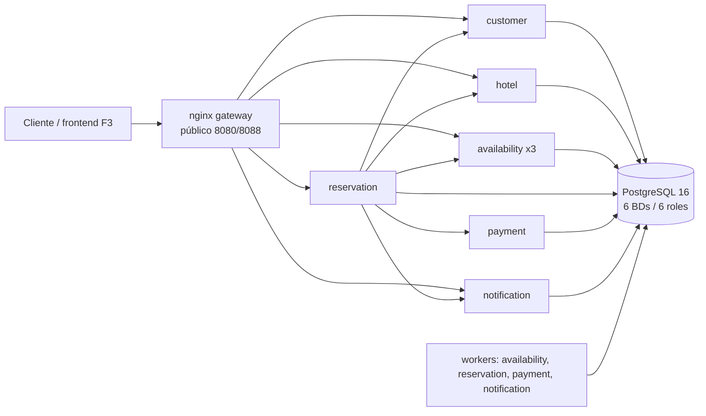

# Plataforma de reservas: microservicios, alta disponibilidad y recuperación ante fallos

Caso 2 · Universidad Central del Ecuador · Programación distribuida

**Estado:** F5 (documentación y entrega). Tag `v1.0-entrega`; informe en
[`docs/informe/INFORME.md`](docs/informe/INFORME.md) y limitaciones honestas
en [`docs/RELEASE.md`](docs/RELEASE.md).

## ¿Está listo para correr y probar desde cero?

| Escenario | Estado | Evidencia |
|---|---|---|
| **Local desde el código** (`git clone` + `make`) | **Sí** | Ensayo limpio de 37 min 20 s con todos los pasos: [`docs/resultados/ensayo-desde-cero.md`](docs/resultados/ensayo-desde-cero.md); CI verde en la rama de entrega |
| **Desde imágenes en Docker Hub** | **Preparado, pero no publicado/probado aún** | Las 6 imágenes se pueden etiquetar y subir; el `compose.yaml` actual usa `:local` y monta el gateway desde el repo. Pasos abajo; falta hacer el push y probar en un host limpio |
| **Producción real** | **No tal cual** | Sin TLS, autenticación, WAF/CDN, HA de PostgreSQL ni observabilidad: ver [`docs/produccion.md`](docs/produccion.md) y [`docs/seguridad.md`](docs/seguridad.md) |

## Qué es

Plataforma de reservas de hoteles con **6 microservicios Docker**
(`customer`, `hotel`, `availability`, `reservation`, `payment`,
`notification`), PostgreSQL con 6 BDs y un gateway nginx. El foco es la
**integridad del negocio** (sin sobreventa, sin cobros duplicados), el
**aislamiento de fallos** y la **evidencia automatizada** de qué funciona,
qué falla y cómo se recupera.

## Contenedores: qué hace cada uno

`docker compose config --services` lista 19 servicios: 6 APIs, 5 workers,
6 jobs de migración, gateway y PostgreSQL.

| Contenedor | Tipo | Qué hace | Puerto |
|---|---|---|---|
| `gateway` | nginx | Única entrada HTTP: sirve el frontend (`/`), enruta `/api/*`, balancea `availability`, aplica límites (429) y cabeceras de seguridad. En dev publica también el listener admin (8081) | 8080 (prod) / 8088+8081 (dev) |
| `postgres` | PostgreSQL 16 | 6 BDs (`customer_db`, `hotel_db`, `availability_db`, `reservation_db`, `payment_db`, `notification_db`) con 6 roles; volumen `pgdata` | 5432 interno; 5433 loopback en dev |
| `customer` | API | Clientes (`POST/GET /customers`); dueño de `customer_db` | interno |
| `hotel` | API | Hoteles, habitaciones y precios; **fuente de verdad** de datos maestros (ADR-0010) | interno |
| `availability` | API ×3 | Inventario, disponibilidad y holds; escritura atómica y **fail-closed** (ADR-0005); 3 réplicas por defecto | interno |
| `reservation` | API | Crea/consulta/cancela reservas; orquesta la saga con `advance(reservation_id)` (ADR-0003); espera síncrona hasta `SAGA_SYNC_WAIT_SECONDS` | interno |
| `payment` | API | Adapter del proveedor de pago y simulación (`ok`, `decline`, `process_then_drop_response`, `slow`); idempotente por `reservation_id` (ADR-0006) | interno |
| `notification` | API | Lectura pública del estado de notificaciones (fail-open) | interno (vía `/api/notifications`) |
| `availability-worker` | Worker | Expira holds vencidos (barrido con `SKIP LOCKED`/lease) | — |
| `reservation-worker` | Worker | Recupera reservas atascadas llamando a la misma `advance` (lease `locked_until`) | — |
| `reservation-relay` | Worker | Publica el **outbox** de reservas hacia notification (lease) | — |
| `payment-worker` | Worker | Reconcilia pagos `UNKNOWN`/técnicos (idempotente, `SKIP LOCKED`) | — |
| `notification-worker` | Worker | Entrega notificaciones con reintentos/backoff; inbox idempotente por `event_id` | — |
| `*-migrate` (6) | Job | `alembic upgrade head` una vez por BD; terminan con exit 0 (no son servidores) | — |

- Los **workers** son procesos separados para que una API lenta o caída no
  detenga la recuperación/entrega.
- Solo el **gateway** publica puertos; los servicios viven en `backend-net`
  y `data-net` (internas). `customer`/`hotel`/`availability`/`reservation`/
  `payment`/`notification` no exponen puerto al host.
- `make up`/`up-dev` usa el perfil **dev** (admin 8081 + público 8088);
  `make up-prod` usa solo el público (8080).

## Arquitectura



- Saga orquestada con `advance(reservation_id)` (ADR-0003); inventario
  atómico/fail-closed (ADR-0005); pago idempotente (ADR-0006); outbox +
  relay + inbox (ADR-0004); gateway con DNS dinámico y reintentos solo en
  idempotentes (ADR-0007).
- Frontend mínimo sin build servido por nginx (`gateway/html`, ADR-0008).

## Quickstart (local, desde el código)

```bash
git clone <repo>
cd reservas-platform
cp .env.example .env
make build && make up && make seed
make smoke && make e2e && make invariants
# frontend: http://127.0.0.1:8088/
```

Requiere Docker Desktop (WSL2) con **≥ 6 GB** de RAM, GNU Make, git y Python
3.12+. Detalle, comandos y problemas en [`docs/manual.md`](docs/manual.md).

## Ciclo completo desde cero (local)

1. **Requisitos:** Docker Desktop/WSL2 con ≥ 6 GB, `make`, `git`, Python
   3.12+. La primera vez necesita red para imágenes base/dependencias.
2. **Clonar y configurar:**
   ```bash
   git clone <repo> && cd reservas-platform
   cp .env.example .env
   ```
3. **Construir y arrancar:**
   ```bash
   make build       # 6 imágenes :local (multistage)
   make up          # perfil dev: público 8088, admin 8081; genera secretos
   make seed        # hoteles, habitaciones, clientes e inventario
   ```
4. **Verificar que está sano:**
   ```bash
   make smoke        # frontend, cabeceras y rutas internas no expuestas
   make invariants   # I1–I7 ⇒ 0
   ```
   Abrir `http://127.0.0.1:8088/` y probar los 3 flujos (ok, decline,
   process_then_drop_response).
5. **Pruebas automatizadas:**
   ```bash
   make test         # unitarias + invariantes (detiene workers temporalmente)
   make up           # IMPORTANTE: vuelve a levantar los workers que make test detuvo
   make e2e          # 11 pruebas de flujo (incluye el flujo público de la UI)
   make check-docs   # variables usadas = documentadas
   make invariants
   ```
6. **Resiliencia (caos):**
   ```bash
   make chaos        # A, B, C, D, E1, E2, E4, S, S2 (E3 se omite por seguridad)
   # E3 borra el volumen del proyecto y restaura el backup: solo en una copia/prueba
   CHAOS_ALLOW_VOLUME_DELETE=1 make chaos SCEN=E3
   # En PowerShell: $env:CHAOS_ALLOW_VOLUME_DELETE="1"; make chaos SCEN=E3
   ```
   Los informes quedan en `docs/resultados/chaos_*.md` (5 preguntas del
   enunciado, RTO/TTD y timeline).
7. **Rendimiento y reporte:**
   ```bash
   make perf PERF=P1     # 1 vs 3 réplicas de availability (~10 min)
   make perf PERF=P3b    # contención aislada (~5 min)
   make perf PERF=P4     # límite público y canario
   make perf             # todas (P1, P3, P3b, P4)
   make report           # REPORTE.md + fallos.md
   ```
8. **Backup/restauración:**
   ```bash
   make backup                              # backups/<timestamp>/
   make restore DIR=backups/<timestamp>     # restaura las 6 BDs
   ```
9. **Apagar/limpiar:**
   ```bash
   make down        # conserva datos
   make clean       # borra contenedores y volúmenes
   make clean-all   # + borra secrets/seed.json
   ```

**Tiempos medidos en el ensayo limpio** (con caché de Docker): build 3,3 s;
up 21,5 s; seed 16,5 s; test 210,8 s; e2e 63 s; chaos 1.036,6 s; perf
769,9 s; total **37 min 20 s**. En una máquina sin caché, el primer build
tarda más. Ver [`resultados/ensayo-desde-cero.md`](docs/resultados/ensayo-desde-cero.md).

## Pruebas del enunciado (14 puntos)

| # | Punto | Cómo probarlo | Evidencia |
|---|---|---|---|
| 1 | Análisis de requerimientos | `make test`; leer `docs/fases/F0-negocio-y-resiliencia.md` | F0 + invariantes |
| 2 | 6 microservicios | `docker compose config --services`; `make images` | `services/*`, `compose.yaml` |
| 3 | Red Docker y exposición mínima | `make smoke`; `pytest tests/e2e/test_public_flow.py -q` | `seguridad.md`, tests |
| 4 | Imágenes optimizadas/multistage | `make build`; `make images` | `imagenes.md` |
| 5 | Configuración externa | `make check-docs` | `variables.md`, `.env.example` |
| 6 | Persistencia y borrado/recreación | `make e2e`; `make chaos SCEN=D`; `make backup`/`restore` | `chaos_D_stop_1.md`, `chaos_E1_*`, `chaos_E3_*` |
| 7 | Múltiples instancias y balanceo | `make perf PERF=P1`; `make chaos SCEN=B` | `perf_P1.md`, `chaos_B_*` |
| 8 | Healthchecks | `make chaos SCEN=S`; `make chaos SCEN=S2` | `chaos_S_stop_1.md`, `chaos_S2_*` |
| 9 | Escenarios A–D (5 preguntas) | `make chaos SCEN=A` (y B/C/D); o `make chaos` | `chaos_A_*` … `chaos_D_*`, `fallos.md` |
| 10 | Compose + Swarm | `docker compose config`; leer `docs/swarm.md` | `compose.yaml`, `swarm.md` |
| 11 | Rendimiento 1 vs N y cuellos | `make perf PERF=P1`; `PERF=P3`; `PERF=P3b`; `PERF=P4` | `perf_*.md`, `REPORTE.md` |
| 12 | Seguridad | `make smoke`; `test_public_flow`; `make perf PERF=P4`; trivy/gitleaks | `seguridad.md`, `seguridad-trivy.txt` |
| 13 | Documentación | `docs/` + `README` + `INFORME.md` | docs |
| 14 | Entregable funcional | Ciclo completo de arriba | ensayo + CI |

- `make chaos` sin `CHAOS_ALLOW_VOLUME_DELETE=1` **omite E3** por seguridad.
- Los escenarios A–D responden las 5 preguntas del enunciado en cada
  `chaos_<ID>_*.md`.
- `make test` **detiene workers**; ejecuta `make up` (o `make e2e`) después
  para dejarlos activos.
- `make perf` y `make chaos` son comparativos en una máquina; ver
  limitaciones.

## Docker Hub y ambientes reales

Las 6 imágenes son autocontenidas (multistage, non-root). El gateway y
PostgreSQL usan imágenes oficiales (`nginx:1.27.4-alpine`, `postgres:16`).
**El `compose.yaml` actual referencia `:local` y monta `gateway/` desde el
repo**, así que para usar Docker Hub hay que publicar las 6 y usar un
override. No se ha probado todavía contra un registry; estos son los pasos.

1. **Publicar** (en la máquina que construyó):
   ```bash
   export DOCKERHUB_USER=tuusuario
   for s in customer hotel availability reservation payment notification; do
     docker tag "$s:local" "$DOCKERHUB_USER/reservas-$s:1.0"
     docker push "$DOCKERHUB_USER/reservas-$s:1.0"
   done
   ```
2. **En el host de prueba**, clonar el repo (hacen falta `compose.yaml`,
   `gateway/`, `scripts/` y `.env.example`), copiar `.env` y crear un
   override `compose.hub.yaml`:
   ```yaml
   services:
     customer:      { image: TUUSUARIO/reservas-customer:1.0 }
     hotel:         { image: TUUSUARIO/reservas-hotel:1.0 }
     availability:  { image: TUUSUARIO/reservas-availability:1.0 }
     reservation:   { image: TUUSUARIO/reservas-reservation:1.0 }
     payment:       { image: TUUSUARIO/reservas-payment:1.0 }
     notification:  { image: TUUSUARIO/reservas-notification:1.0 }
   ```
3. **Arrancar desde las imágenes** (perfil dev para poder sembrar):
   ```bash
   cp .env.example .env
   make secrets
   docker compose -f compose.yaml -f compose.dev.yaml -f compose.hub.yaml \
     up -d --no-build --wait
   make seed && make smoke
   # UI: http://127.0.0.1:8088/
   ```
   `--no-build` ignora `build:` y usa las imágenes; si no están locales,
   Docker las descarga. El listener admin (8081) solo existe en dev y es
   necesario para `make seed`; en `up-prod` no se publica.
4. **Multi-arquitectura** (Apple Silicon/ARM): reconstruir con
   `docker buildx build --platform linux/amd64,linux/arm64 --push` para cada
   servicio.
5. **Limitaciones para un ambiente real:** no hay TLS ni autenticación;
   no expongas el 8081; usa un proxy TLS/WAF delante del 8080; define
   backups/HA de PostgreSQL, observabilidad y rotación de secretos
   ([`docs/produccion.md`](docs/produccion.md),
   [`docs/seguridad.md`](docs/seguridad.md)). Los secretos se generan en el
   host (`make secrets`), no viajan en las imágenes.

> **Veredicto:** listo y probado para local desde el código. Preparado para
> publicar en Docker Hub, pero el flujo registry→host limpio aún no se ha
> ejecutado; haz una prueba en un host nuevo antes de la defensa. Para
> producción real faltan los controles de `produccion.md`.

## Comandos

| Comando | Qué hace |
|---|---|
| `make build` / `make up` / `make up-prod` | imágenes / perfil dev / perfil público |
| `make seed` | siembra idempotente |
| `make test` / `make e2e` | unitarias + invariantes / flujo completo |
| `make smoke` | frontend, cabeceras y rutas internas no expuestas |
| `make invariants` | I1–I7 (debe dar 0) |
| `make chaos [SCEN=...]` | A, B, C, D, E1–E4, S, S2 |
| `make perf [PERF=...]` | k6: P1, P3, P3b, P4 |
| `make report` | `REPORTE.md` + `fallos.md` |
| `make backup` / `make restore DIR=...` | dumps/restauración de las 6 BDs |
| `make images` / `make prune` | inventario de imágenes / limpieza |
| `make check-docs` | variables usadas = documentadas |
| `make down` / `make clean` / `make clean-all` | detener / borrar volúmenes / + semilla |

## Hallazgos clave (con evidencia)

| Hallazgo | Cifra / resultado | Evidencia |
|---|---|---|
| Notificaciones no bloquean reservas | 0 pérdidas, backlog drenado | `resultados/chaos_A_*.md` |
| Caída de 1 de 3 réplicas de availability | p95 sano; un outlier de **2,41 s** (1/5) | `chaos_B_kill_*.md` |
| Reinicio de `reservation` / PostgreSQL | estados estables; 1 cargo/reserva; D recreación real | `chaos_C_*.md`, `chaos_D_stop_1.md` |
| Durabilidad con caída de PostgreSQL | **200/200** acks durables (E1) | `chaos_E1_*.md` |
| Restauración de backup | RTO ~30,5 s; **RPO 5/5** reservas perdidas tras el backup | `chaos_E3_*.md` |
| Healthcheck de PostgreSQL | TTD **93,21 s** (> 30 s por `retries=12`); TTR 3,43 s | `chaos_S_stop_1.md` |
| Lectura 1 vs 3 réplicas | **189 → 394 rps (2,09×)**, sublineal | `perf_P1.md`, `perf_P1_analisis.md` |
| Contención de inventario | V1 acumula locks (8–41) y V2 casi ninguno; K exacto | `perf_P3b.md` |
| Límite público | **141** y **45** respuestas 429; canario admin estable | `perf_P4.md` |
| Seguridad | 47 HIGH/0 CRITICAL por imagen; gitleaks 0 | `seguridad.md`, `resultados/seguridad-trivy.txt` |

## Documentación

- [`docs/03-estado-del-proyecto.md`](docs/03-estado-del-proyecto.md): mapa de lectura.
- [`docs/04-arquitectura.md`](docs/04-arquitectura.md) y [`docs/adr/`](docs/adr/README.md).
- [`docs/05-contratos-api.md`](docs/05-contratos-api.md): contratos y estados.
- [`docs/manual.md`](docs/manual.md): instalación, comandos, frontend, problemas.
- [`docs/seguridad.md`](docs/seguridad.md), [`docs/produccion.md`](docs/produccion.md), [`docs/swarm.md`](docs/swarm.md), [`docs/imagenes.md`](docs/imagenes.md), [`docs/variables.md`](docs/variables.md).
- [`docs/resultados/REPORTE.md`](docs/resultados/REPORTE.md): consolidado de caos y carga.
- [`docs/resultados/ensayo-desde-cero.md`](docs/resultados/ensayo-desde-cero.md): ensayo reproducible.
- [`docs/informe/INFORME.md`](docs/informe/INFORME.md): borrador del informe.

## Limitaciones (resumen)

- Un solo PostgreSQL (punto único de fallo); sin PITR ni réplica.
- RPO depende de un `make backup` manual; dumps por BD no consistentes entre
  servicios.
- S TTD ≈ 93 s > objetivo de 30 s (`retries=12`).
- B/kill con outlier intermitente de 2,41 s.
- P2 y P5 (mezcla y rampa de la mezcla) no ejecutados; resultados de una sola
  máquina, comparativos.
- Sin TLS, autenticación, WAF/CDN ni observabilidad de producción.
- 47 HIGH/0 CRITICAL por imagen (base Debian + `starlette`), pendiente de
  actualización.

Lista completa y trabajo futuro en [`docs/RELEASE.md`](docs/RELEASE.md).
