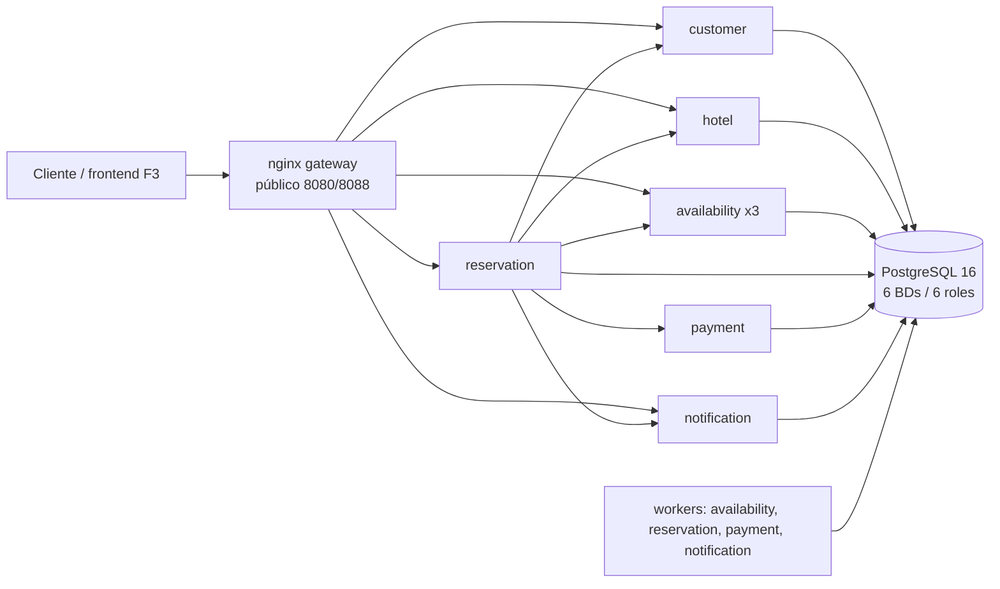

# Plataforma de reservas: microservicios, alta disponibilidad y recuperación ante fallos

Caso 2 · Universidad Central del Ecuador · Programación distribuida

**Estado:** F5 (documentación y entrega). La solución está implementada,
probada y medida; el informe de entrega está en
[`docs/informe/INFORME.md`](docs/informe/INFORME.md) y las limitaciones
honestas en [`docs/RELEASE.md`](docs/RELEASE.md).

## Qué es

Plataforma de reservas de hoteles con **6 microservicios Docker**
(`customer`, `hotel`, `availability`, `reservation`, `payment`,
`notification`), PostgreSQL con 6 BDs y un gateway nginx. El foco es la
**integridad del negocio** (sin sobreventa, sin cobros duplicados), el
**aislamiento de fallos** y la **evidencia automatizada** de qué funciona,
qué falla y cómo se recupera.

## Arquitectura



- Comunicación solo por HTTP y **redes internas** (`backend-net`,
  `data-net`); solo el gateway publica puerto (`docs/seguridad.md`).
- Saga orquestada con `advance(reservation_id)` y estados persistidos
  (ADR-0003); inventario atómico/fail-closed (ADR-0005); pago idempotente
  (ADR-0006); outbox + relay + inbox (ADR-0004).
- Frontend mínimo sin build servido por nginx (`gateway/html`, ADR-0008).

## Quickstart

```bash
cp .env.example .env
make build && make up && make seed
make smoke && make e2e && make invariants
# frontend: http://127.0.0.1:8088/
```

Requiere Docker Desktop (WSL2) con **≥ 6 GB** de RAM, GNU Make, git y Python
3.12+. Detalle, comandos y solución de problemas en
[`docs/manual.md`](docs/manual.md).

## Comandos

| Comando | Qué hace |
|---|---|
| `make build` / `make up` / `make up-prod` | imágenes / perfil dev / perfil público |
| `make seed` | siembra idempotente |
| `make test` / `make e2e` | unitarias + invariantes / flujo completo |
| `make smoke` | frontend, cabeceras y rutas internas no expuestas |
| `make invariants` | I1–I7 (debe dar 0) |
| `make chaos [SCEN=...]` | A, B, C, D, E1–E4, S, S2 |
| `make perf [PERF=...]` | k6: P1, P3, P3b, P4 |
| `make report` | `REPORTE.md` + `fallos.md` |
| `make backup` / `make restore DIR=...` | dumps/restauración de las 6 BDs |
| `make images` / `make prune` | inventario de imágenes / limpieza |
| `make check-docs` | variables usadas = documentadas |
| `make down` / `make clean` / `make clean-all` | detener / borrar volúmenes / + semilla |

## Hallazgos clave (con evidencia)

| Hallazgo | Cifra / resultado | Evidencia |
|---|---|---|
| Notificaciones no bloquean reservas | 0 pérdidas, backlog drenado | `resultados/chaos_A_*.md` |
| Caída de 1 de 3 réplicas de availability | p95 sano; un outlier de **2,41 s** (1/5) | `chaos_B_kill_*.md` |
| Reinicio de `reservation` / PostgreSQL | estados estables; 1 cargo/reserva; D recreación real | `chaos_C_*.md`, `chaos_D_stop_1.md` |
| Durabilidad con caída de PostgreSQL | **200/200** acks durables (E1) | `chaos_E1_*.md` |
| Restauración de backup | RTO ~30,5 s; **RPO 5/5** reservas perdidas tras el backup | `chaos_E3_*.md` |
| Healthcheck de PostgreSQL | TTD **93,21 s** (> 30 s por `retries=12`); TTR 3,43 s | `chaos_S_stop_1.md` |
| Lectura 1 vs 3 réplicas | **189 → 394 rps (2,09×)**, sublineal | `perf_P1.md`, `perf_P1_analisis.md` |
| Contención de inventario | V1 acumula locks (8–41) y V2 casi ninguno; K exacto | `perf_P3b.md` |
| Límite público | **141** y **45** respuestas 429; canario admin estable | `perf_P4.md` |
| Seguridad | 47 HIGH/0 CRITICAL por imagen; gitleaks 0 | `seguridad.md`, `resultados/seguridad-trivy.txt` |

## Documentación

- [`docs/03-estado-del-proyecto.md`](docs/03-estado-del-proyecto.md): mapa de lectura.
- [`docs/04-arquitectura.md`](docs/04-arquitectura.md) y [`docs/adr/`](docs/adr/README.md).
- [`docs/05-contratos-api.md`](docs/05-contratos-api.md): contratos y estados.
- [`docs/manual.md`](docs/manual.md): instalación, comandos, frontend, problemas.
- [`docs/seguridad.md`](docs/seguridad.md), [`docs/produccion.md`](docs/produccion.md), [`docs/swarm.md`](docs/swarm.md), [`docs/imagenes.md`](docs/imagenes.md), [`docs/variables.md`](docs/variables.md).
- [`docs/resultados/REPORTE.md`](docs/resultados/REPORTE.md): consolidado de caos y carga.
- [`docs/informe/INFORME.md`](docs/informe/INFORME.md): borrador del informe (secciones pendientes marcadas).

## Limitaciones (resumen)

- Un solo PostgreSQL (punto único de fallo); sin PITR ni réplica.
- RPO depende de un `make backup` manual; dumps por BD no consistentes entre
  servicios.
- S TTD ≈ 93 s > objetivo de 30 s (`retries=12`).
- B/kill con outlier intermitente de 2,41 s.
- P2 y P5 (mezcla y rampa de la mezcla) no ejecutados; resultados de una sola
  máquina, comparativos.
- Sin TLS, autenticación, WAF/CDN ni observabilidad de producción.
- 47 HIGH/0 CRITICAL por imagen (base Debian + `starlette`), pendiente de
  actualización.

Lista completa y trabajo futuro en [`docs/RELEASE.md`](docs/RELEASE.md).
