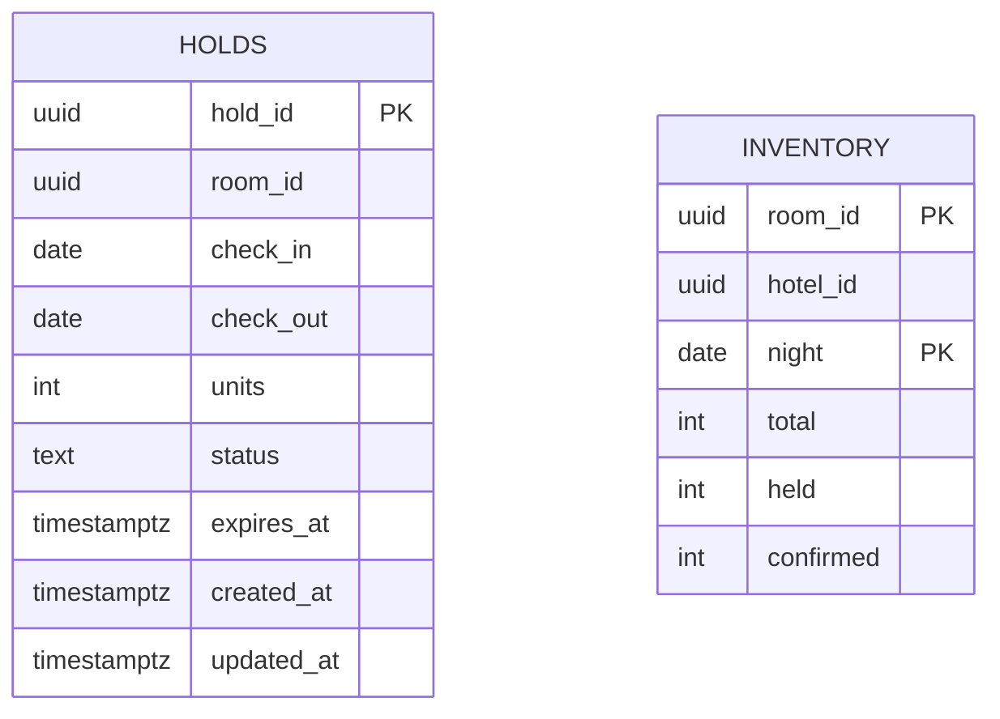

# Diagrama ER — `availability_db`

Fuente Mermaid generada desde el catálogo real. GitHub la renderiza;
para exportar PNG/SVG, pega el bloque en <https://mermaid.live>.
Se omiten `alembic_version` (infraestructura) y los datos. Dueño: `availability`.

## Restricciones CHECK y UNIQUE compuestas

Se validan en la base y no se dibujan como aristas:

- `holds.holds_check`: `CHECK ((check_out > check_in))`
- `holds.holds_status_check`: `CHECK ((status = ANY (ARRAY['HELD'::text, 'CONFIRMED'::text, 'RELEASED'::text, 'EXPIRED'::text])))`
- `holds.holds_units_check`: `CHECK ((units > 0))`
- `inventory.inventory_check`: `CHECK (((held + confirmed) <= total))`
- `inventory.inventory_confirmed_check`: `CHECK ((confirmed >= 0))`
- `inventory.inventory_held_check`: `CHECK ((held >= 0))`
- `inventory.inventory_total_check`: `CHECK ((total >= 0))`
