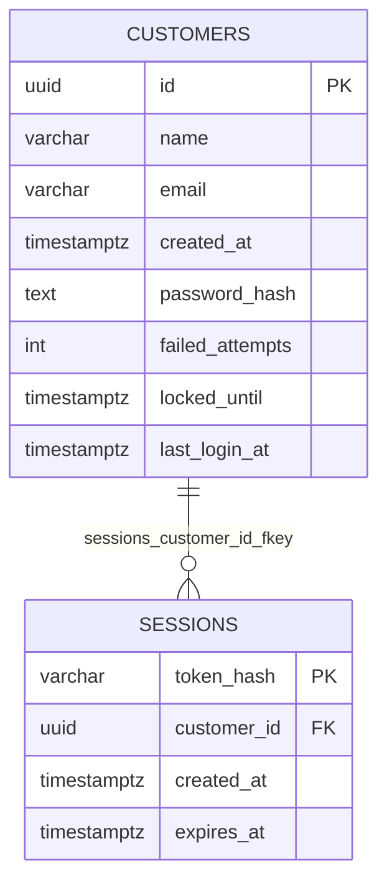

# Diagrama ER — `customer_db`

Fuente Mermaid generada desde el catálogo real. GitHub la renderiza;
para exportar PNG/SVG, pega el bloque en <https://mermaid.live>.
Se omiten `alembic_version` (infraestructura) y los datos. Dueño: `customer`.

## Restricciones CHECK y UNIQUE compuestas

Se validan en la base y no se dibujan como aristas:

