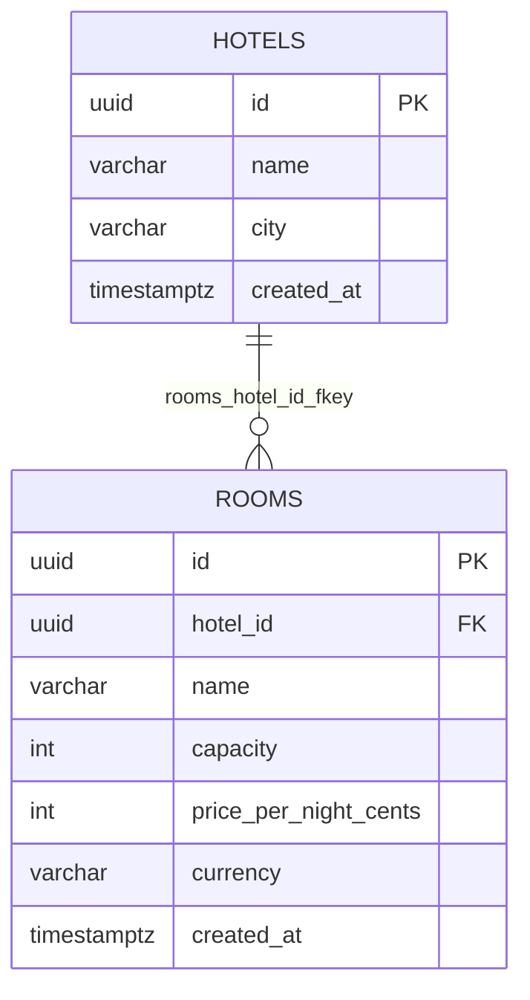

# Diagrama ER — `hotel_db`

Fuente Mermaid generada desde el catálogo real. GitHub la renderiza;
para exportar PNG/SVG, pega el bloque en <https://mermaid.live>.
Se omiten `alembic_version` (infraestructura) y los datos. Dueño: `hotel`.

## Restricciones CHECK y UNIQUE compuestas

Se validan en la base y no se dibujan como aristas:

- `rooms.rooms_capacity_check`: `CHECK (((capacity >= 1) AND (capacity <= 10)))`
- `rooms.rooms_currency_check`: `CHECK (((currency)::text = 'USD'::text))`
- `rooms.rooms_price_check`: `CHECK ((price_per_night_cents > 0))`
