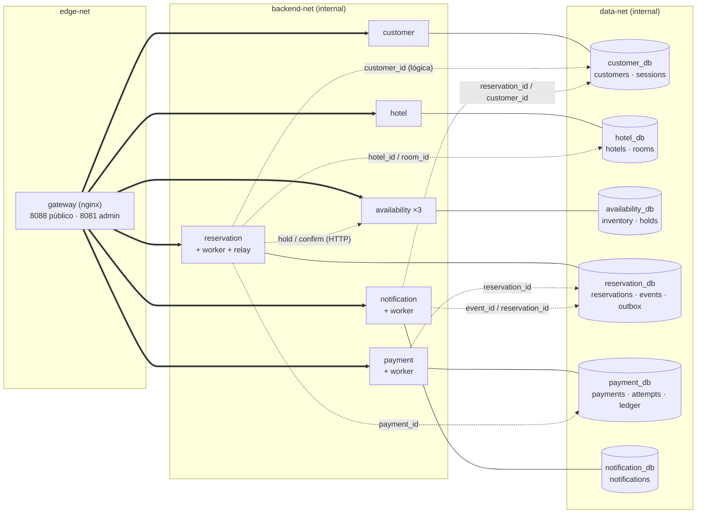

# Diagrama lógico global — 6 servicios, 6 bases, referencias cruzadas

Este diagrama no sale del catálogo SQL (las referencias entre bases no son
FK), sino de la arquitectura del proyecto: `compose.yaml`, `docs/04-arquitectura.md`,
`docs/05-contratos-api.md` y los ADR 0002/0003/0004/0010.

**Leyenda**

- `==>` HTTP de entrada por el gateway (único puerto público).
- `---` propiedad: el servicio es dueño exclusivo de esa base.
- `-.->` referencia lógica o llamada HTTP **sin FK**. No hay claves foráneas
  entre bases distintas (ADR-0002).

## Referencias lógicas (11)

| # | Origen (base.tabla.columna) | Destino | Para qué |
|---|---|---|---|
| 1 | `reservation_db.reservations.customer_id` | `customer_db.customers.id` | saber quién reserva |
| 2 | `reservation_db.reservations.hotel_id` | `hotel_db.hotels.id` | hotel reservado |
| 3 | `reservation_db.reservations.room_id` | `hotel_db.rooms.id` | habitación reservada |
| 4 | `reservation_db.reservations.payment_id` | `payment_db.payments.id` | correlación con el cobro |
| 5 | `availability_db.inventory.room_id` | `hotel_db.rooms.id` | inventario por habitación |
| 6 | `availability_db.inventory.hotel_id` | `hotel_db.hotels.id` | consultas por hotel |
| 7 | `availability_db.holds.room_id` | `hotel_db.rooms.id` | hold de una habitación |
| 8 | `payment_db.payments.reservation_id` | `reservation_db.reservations.id` | idempotencia por reserva |
| 9 | `notification_db.notifications.reservation_id` | `reservation_db.reservations.id` | contexto de la notificación |
| 10 | `notification_db.notifications.customer_id` | `customer_db.customers.id` | destinatario |
| 11 | `notification_db.notifications.event_id` | `reservation_db.outbox.id` | deduplicación del evento |

## Relaciones físicas (5 FK, todas dentro de una base)

| Base | FK | Cardinalidad |
|---|---|---|
| `customer_db` | `sessions.customer_id → customers.id` (ON DELETE CASCADE) | 1 cliente : N sesiones |
| `hotel_db` | `rooms.hotel_id → hotels.id` (ON DELETE RESTRICT) | 1 hotel : N habitaciones |
| `payment_db` | `ledger.payment_id → payments.id` | 1 pago : N asientos |
| `payment_db` | `payment_attempts.payment_id → payments.id` | 1 pago : N intentos |
| `reservation_db` | `reservation_events.reservation_id → reservations.id` | 1 reserva : N eventos |

## Por qué no hay FK entre bases

1. **Propiedad exclusiva** (ADR-0002): cada servicio solo escribe su base; una
   FK obligaría a que el motor de una base conozca datos de otra y rompería el
   aislamiento por rol.
2. **Despliegue independiente**: las bases comparten instancia pero podrían
   separarse sin migrar constraints.
3. **Saga y compensaciones** (ADR-0003): la coherencia entre servicios se
   resuelve con la máquina de estados de `reservations` y compensaciones
   (`REFUND_REQUIRED`, `CANCELLING`), no con integridad transaccional
   distribuida.
4. **Outbox** (ADR-0004): `outbox` + relay dan entrega al menos una vez y
   `notifications.event_id` (UNIQUE) da idempotencia.

La comprobación automática de estas referencias está en
[`../integrity.md`](../integrity.md); el detalle de columnas, en
[`../inventory.md`](../inventory.md).
