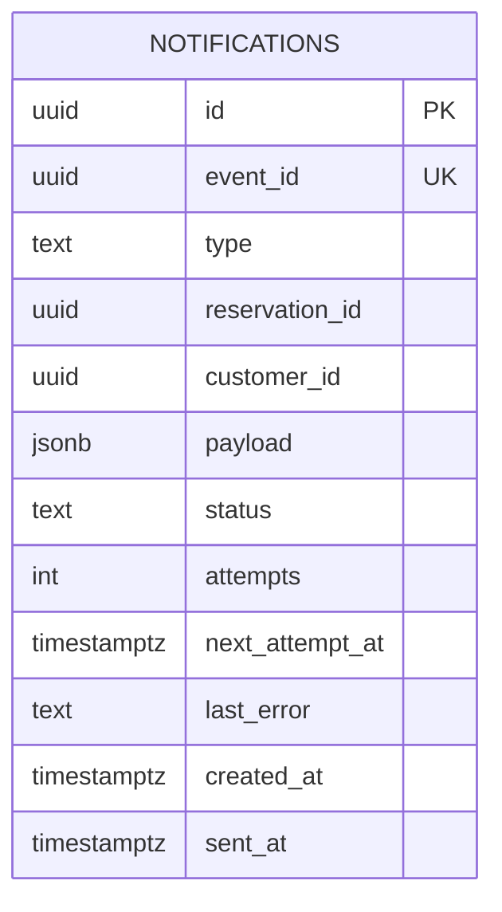

# Diagrama ER — `notification_db`

Fuente Mermaid generada desde el catálogo real. GitHub la renderiza;
para exportar PNG/SVG, pega el bloque en <https://mermaid.live>.
Se omiten `alembic_version` (infraestructura) y los datos. Dueño: `notification`.

## Restricciones CHECK y UNIQUE compuestas

Se validan en la base y no se dibujan como aristas:

- `notifications.notifications_event_id_key`: `UNIQUE (event_id)`
- `notifications.notifications_status_check`: `CHECK ((status = ANY (ARRAY['PENDING'::text, 'SENT'::text, 'FAILED'::text])))`
- `notifications.notifications_type_check`: `CHECK ((type = ANY (ARRAY['reservation.confirmed'::text, 'reservation.cancelled'::text])))`
