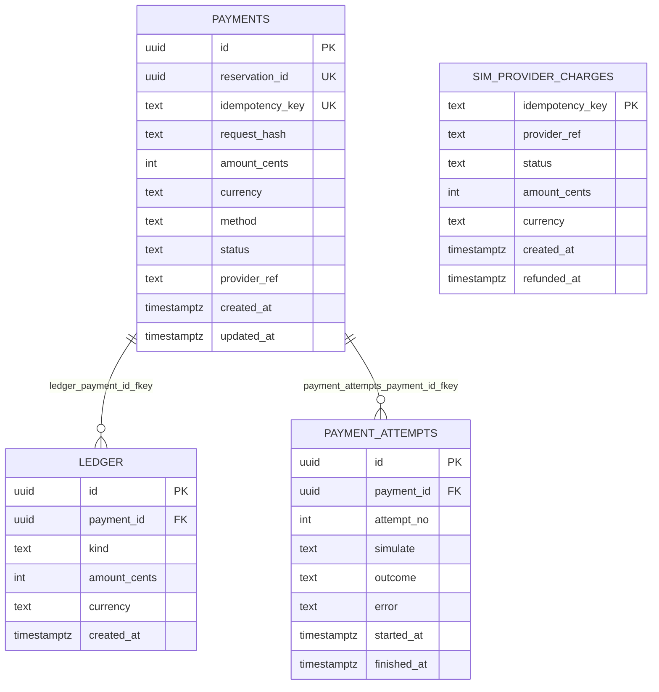

# Diagrama ER — `payment_db`

Fuente Mermaid generada desde el catálogo real. GitHub la renderiza;
para exportar PNG/SVG, pega el bloque en <https://mermaid.live>.
Se omiten `alembic_version` (infraestructura) y los datos. Dueño: `payment`.

## Restricciones CHECK y UNIQUE compuestas

Se validan en la base y no se dibujan como aristas:

- `ledger.ledger_kind_check`: `CHECK ((kind = ANY (ARRAY['CHARGE'::text, 'REFUND'::text])))`
- `ledger.ledger_payment_id_kind_key`: `UNIQUE (payment_id, kind)`
- `payment_attempts.payment_attempts_payment_id_attempt_no_key`: `UNIQUE (payment_id, attempt_no)`
- `payments.payments_amount_cents_check`: `CHECK ((amount_cents > 0))`
- `payments.payments_idempotency_key_key`: `UNIQUE (idempotency_key)`
- `payments.payments_reservation_id_key`: `UNIQUE (reservation_id)`
- `payments.payments_status_check`: `CHECK ((status = ANY (ARRAY['INITIATED'::text, 'SUCCEEDED'::text, 'DECLINED'::text, 'FAILED_TECHNICAL'::text, 'UNKNOWN'::text, 'REFUNDED'::text])))`
- `sim_provider_charges.sim_provider_charges_status_check`: `CHECK ((status = ANY (ARRAY['APPROVED'::text, 'DECLINED'::text])))`
