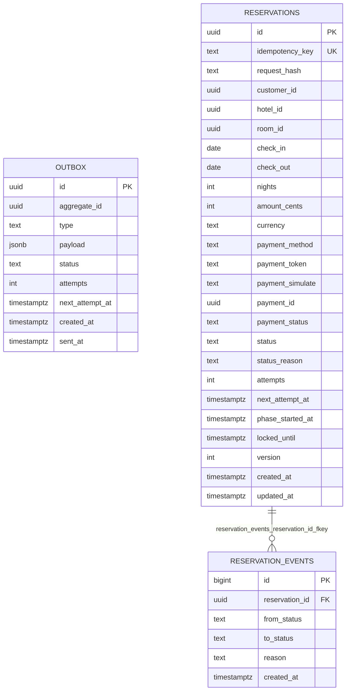

# Diagrama ER — `reservation_db`

Fuente Mermaid generada desde el catálogo real. GitHub la renderiza;
para exportar PNG/SVG, pega el bloque en <https://mermaid.live>.
Se omiten `alembic_version` (infraestructura) y los datos. Dueño: `reservation`.

## Restricciones CHECK y UNIQUE compuestas

Se validan en la base y no se dibujan como aristas:

- `outbox.outbox_status_check`: `CHECK ((status = ANY (ARRAY['PENDING'::text, 'SENT'::text])))`
- `reservations.reservations_amount_cents_check`: `CHECK ((amount_cents > 0))`
- `reservations.reservations_check`: `CHECK ((check_out > check_in))`
- `reservations.reservations_idempotency_key_key`: `UNIQUE (idempotency_key)`
- `reservations.reservations_nights_check`: `CHECK ((nights > 0))`
- `reservations.reservations_payment_simulate_check`: `CHECK ((payment_simulate = ANY (ARRAY['ok'::text, 'decline'::text, 'error_before_processing'::text, 'process_then_drop_response'::text, 'slow'::text])))`
- `reservations.reservations_status_check`: `CHECK ((status = ANY (ARRAY['RECEIVED'::text, 'HELD'::text, 'PAYMENT_PENDING'::text, 'PAYMENT_UNKNOWN'::text, 'PAID'::text, 'CONFIRMED'::text, 'PAYMENT_DECLINED'::text, 'REFUND_REQUIRED'::text, 'CANCELLING'::text, 'CANCELLED'::text, 'REJECTED_NO_INVENTORY'::text, 'FAILED_TECHNICAL'::text, 'MANUAL_REVIEW'::text])))`
