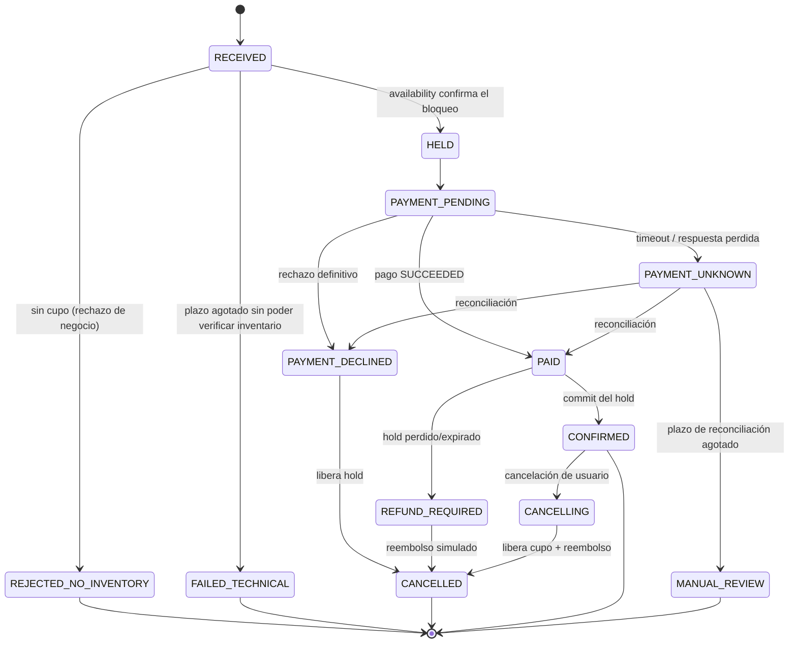

# F0: Análisis del negocio y diseño de resiliencia (v1.0, G0 cerrado el 2026-10-19)

> **Erratas v0.2 (ver ADR-0003):** (1) se elimina el estado `HOLD_REQUESTED`: es `RECEIVED` (se persiste antes de llamar y la llamada es idempotente); (2) la validación de cliente/habitación (solo lecturas) ocurre **antes** de persistir `RECEIVED`; (3) se añade `CANCELLING` para que la cancelación sea recuperable. Arquitectura en `../04-arquitectura.md`; contratos en `../05-contratos-api.md`.

> **G0 cerrado (2026-10-19):** supuestos de §6 confirmados y ADR 0001-0010 aceptados. `reservation` valida hoteles y habitaciones por HTTP contra `hotel`, que es la fuente de verdad (ADR-0010); `availability` gestiona exclusivamente inventario, disponibilidad y holds. Las dependencias síncronas usan timeouts y manejo explícito de errores. Evolución: replicar datos de lectura de `hotel` mediante eventos si la carga demuestra que la llamada limita el rendimiento.

> **Principio de diseño:** no necesitamos que todos los componentes estén siempre disponibles. Necesitamos que los componentes críticos **preserven la integridad del negocio**, que el sistema **falle de forma controlada** y que **pueda recuperarse**. El stack responde a esto, no al revés.

Este documento es la fuente de verdad para F1 en adelante. Todo lo marcado **[SUPUESTO]** quedó validado en G0 (sección 6).

---

## 0. Qué no puede perderse (invariantes de negocio)

Estas reglas se verifican con un **chequeador de invariantes** (`tests/invariants/`) que se ejecuta después de cada prueba de integración, caos y carga. Si alguna se rompe, la prueba falla aunque el sistema "respondiera bien".

| ID | Invariante | Consecuencia si se rompe |
|---|---|---|
| I1 | **Sin sobreventa:** `held + confirmed ≤ total` por habitación y noche (además, `CHECK` en la BD) | Cliente con reserva sin habitación; costo reputacional |
| I2 | **Una reserva por intención:** misma `Idempotency-Key` → una sola reserva | Reservas duplicadas |
| I3 | **Un cobro por reserva:** máximo un pago `SUCCEEDED` por reserva | Cobro doble |
| I4 | **No hay reserva `CONFIRMED` sin pago `SUCCEEDED`** (y viceversa, salvo estado transitorio en reconciliación con plazo máximo) | Servicio gratis o cobro sin servicio |
| I5 | **Todo estado no terminal avanza o expira:** ninguna reserva queda en un estado intermedio más allá de su plazo | Inventario bloqueado para siempre; estados incompletos |
| I6 | **Todo `CONFIRMED` genera exactamente un evento de notificación** (entregado o pendiente) | Cliente sin confirmación |
| I7 | **Los datos confirmados sobreviven** a reinicio de contenedor o proceso (con volumen íntegro) | Pérdida de datos comprometidos |

---

## 1. Entregable 1: Flujo de reserva y estados

### 1.1 Secuencia (camino feliz)
```mermaid
sequenceDiagram
    participant C as Cliente
    participant G as Gateway
    participant R as reservation
    participant A as availability
    participant P as payment
    participant N as notification
    C->>G: POST /reservations (Idempotency-Key)
    G->>R: reenvía
    R->>R: 0. busca Idempotency-Key (replay)
    R->>R: 1a. valida cliente/habitación (solo lecturas; customer/hotel, timeout)
    R->>R: 1b. persiste RECEIVED + instantánea + evento (TX)
    R->>A: 2. POST /holds (hold_id = reservation_id, TTL)
    A-->>R: HELD (UPDATE atómico con guarda)
    R->>R: persiste PAYMENT_PENDING
    R->>P: 3. POST /payments (Idempotency-Key = reservation_id)
    P-->>R: SUCCEEDED
    R->>R: persiste PAID
    R->>A: 4. POST /holds/{id}/confirm (idempotente)
    A-->>R: CONFIRMED
    R->>R: 5. CONFIRMED + fila en OUTBOX (misma TX)
    R-->>C: 201 CONFIRMED
    Note over R,N: Fuera del camino crítico
    R-)N: worker del outbox entrega (reintentos, dedupe por event_id)
```
**Regla de oro:** *persistir el estado antes de cada llamada externa.* Si el proceso muere entre dos pasos, el estado en BD dice dónde quedó y un **worker de recuperación** lo continúa.

### 1.2 Máquina de estados de la reserva

- **Estados terminales:** `CONFIRMED`, `REJECTED_NO_INVENTORY`, `FAILED_TECHNICAL`, `CANCELLED`, `MANUAL_REVIEW`.
- **Cada transición** se registra en `reservation_events` (append-only) → auditoría y diagnóstico.
- **Caso peligroso a cubrir con prueba:** pago exitoso pero el hold expiró. Mitigación: mientras el pago esté `PENDING/UNKNOWN`, `reservation` **extiende el hold** (hasta un máximo) y el TTL del hold es mayor que el plazo de pago. Si aun así falla → `REFUND_REQUIRED`.

### 1.3 Máquina de estados del pago
`INITIATED → SUCCEEDED | DECLINED | FAILED_TECHNICAL | UNKNOWN`, y `UNKNOWN → SUCCEEDED | DECLINED` por consulta al proveedor.
Diferenciación clave:
| Resultado | Significado | Qué hace reservation |
|---|---|---|
| `DECLINED` | El proveedor rechazó (fondos, tarjeta) | Libera hold → `CANCELLED`. **No reintentar** |
| `FAILED_TECHNICAL` | No se llegó a procesar (conexión rechazada antes de enviar) | Reintento acotado con **la misma** clave de idempotencia |
| `UNKNOWN` | Se envió y no sabemos si se cobró (timeout, respuesta perdida) | **Consultar estado antes de reintentar**; mantener hold; nunca crear un segundo cobro con otra clave |

---

## 2. Entregable 2: Matriz de criticidad, dependencias y modos de fallo

### 2.1 Clasificación de criticidad (validada y ajustada)
Un ajuste importante respecto a la clasificación inicial: **availability se parte en dos caminos con necesidades opuestas.**

| Componente | Criticidad | Qué se protege | Política ante duda |
|---|---|---|---|
| **availability: escritura** (holds/confirm/release) | **Crítica** (integridad) | I1, I5 | **Fail-closed:** si no puede verificar inventario, rechaza (503). Nunca asume disponibilidad |
| **availability: lectura** (búsqueda/consulta) | Alta (disponibilidad y rendimiento) | Latencia y continuidad | Tolera datos ligeramente desactualizados; **escala con réplicas** |
| **reservation** | **Crítica** | I2, I4, I5 | Persistir antes de actuar; reanudar tras caída |
| **payment** | **Crítica** | I3, I4 | Idempotencia; `UNKNOWN` ≠ fallo; conciliación |
| customer / hotel | Media | Datos maestros | Fail-closed para reservas nuevas (503 controlado) en MVP; evolución: réplica local de datos mínimos |
| notification | Baja | Entrega eventual | **Fail-open:** nunca bloquea ni cancela una reserva confirmada |

**Consecuencia de diseño:** las réplicas ayudan a la *lectura* de availability. La *escritura* se serializa en la BD (bloqueo de fila); más réplicas no la hacen más rápida ni más segura. Esto es lo que mediremos.

### 2.2 Dependencias
| Servicio | Depende de (síncrono) | Si la dependencia falla |
|---|---|---|
| reservation | customer, hotel*, availability, payment, su BD | Rechazo controlado o estado intermedio recuperable (ver 2.3) |
| availability | su BD | 503 en escritura y lectura; sin degradación útil en MVP |
| payment | su BD, proveedor simulado | `FAILED_TECHNICAL` o `UNKNOWN` según el momento del fallo |
| notification | su BD | Eventos quedan en outbox |
| customer / hotel | su BD | 503 |
\* **Decidido en G0 (ADR-0010):** `hotel` es la fuente de verdad de hoteles, habitaciones y precios; `reservation` la consulta por HTTP (con timeout y error explícito). `availability` solo gestiona inventario, disponibilidad y holds; no replica datos maestros. Evolución: replicar datos de lectura mediante eventos si la carga lo justifica, con control de antigüedad y reconciliación.

**Punto único de fallo compartido:** el contenedor PostgreSQL. Si cae, **todos los servicios críticos caen a la vez**. Es la limitación más importante del MVP y se documenta, se prueba y se mitiga con backups; no se oculta.

### 2.3 Modos de fallo (resumen; la versión completa se mantiene en `docs/fallos.md`)
| # | Componente | Modo de fallo | Efecto de negocio | Detección | Política y recuperación | Prueba |
|---|---|---|---|---|---|---|
| F1 | availability (1 de 3 réplicas) | Proceso caído | Lectura sin interrupción sostenida | healthcheck, 5xx del upstream | nginx reintenta en otra réplica (`proxy_next_upstream`, solo lecturas); Docker reinicia | Esc. B |
| F2 | availability (escritura) | Lenta o BD no responde | No se pueden crear holds | timeout | **Fail-closed**: 503; reservation queda en `RECEIVED` y reintenta con backoff hasta el plazo → `FAILED_TECHNICAL` | E1 |
| F3 | availability | Dos solicitudes simultáneas por el último cupo | Riesgo de sobreventa | Invariante I1 | `UPDATE … WHERE held+confirmed < total` atómico + `CHECK` | T-concurrencia |
| F4 | reservation | Reinicio/crash a mitad del flujo | Reservas en estado intermedio | Worker de recuperación escanea no terminales | Reanuda desde el último estado persistido; idempotente en cada paso | Esc. C |
| F5 | reservation | Cliente reenvía la misma solicitud | Duplicado | `Idempotency-Key` única | Devuelve la reserva existente (mismo cuerpo/hash; si el hash difiere → 422) | T-idempotencia |
| F6 | payment | Respuesta perdida tras cobrar | Cobro sin conocer el resultado | timeout | `UNKNOWN` → consulta por ID → resuelve a `SUCCEEDED/DECLINED` | E2 |
| F7 | payment | Doble envío del mismo pago | Cobro doble | Invariante I3 | `UNIQUE(idempotency_key)` | T-idempotencia |
| F8 | payment | Proveedor caído (rechazo de conexión) | No se puede cobrar | error de conexión | `FAILED_TECHNICAL` → reintento acotado → `CANCELLED` + libera hold | T-pago |
| F9 | notification | Servicio caído | Retraso de confirmaciones | fallos de entrega | Outbox con backoff; las reservas siguen `CONFIRMED` | Esc. A |
| F10 | notification | Entrega duplicada (al menos una vez) | Correo repetido | `event_id` | Consumidor idempotente (`UNIQUE(event_id)`) | T-outbox |
| F11 | customer/hotel | Caído | No se aceptan reservas nuevas | timeout | 503 controlado; reservas en curso con datos ya validados continúan | T-maestros |
| F12 | PostgreSQL | `docker kill` durante carga de escritura | Caída total temporal | healthcheck | WAL recovery al arrancar; servicios reconectan; invariantes se verifican | **E1** |
| F13 | PostgreSQL | Contenedor eliminado y recreado con el volumen | Caída total temporal | healthcheck | Datos íntegros por volumen | Esc. D |
| F14 | PostgreSQL | Pérdida del volumen / corrupción | Pérdida de datos | n/a | **Restauración desde backup**; RPO = antigüedad del backup | **E3** |
| F15 | Host | Caída del host | Todo caído | externo | **Fuera del alcance de Compose**; se documenta | (doc) |

---

## 3. Entregable 3: Decisiones de persistencia, consistencia y recuperación por servicio

### 3.1 PostgreSQL (configuración y garantías)
| Tema | Decisión | Nota honesta |
|---|---|---|
| Estructura | 1 contenedor, 6 BDs, 1 rol por BD, sin privilegios cruzados | Sin aislamiento de recursos: un servicio puede saturar al resto. Se mitiga con pools acotados y `statement_timeout`, `lock_timeout`, `idle_in_transaction_session_timeout` |
| Durabilidad | `fsync=on`, `synchronous_commit=on`, `full_page_writes=on` (valores por defecto, **no se relajan**); checksums de datos al hacer `initdb` | La durabilidad real depende del almacenamiento y hardware. `docker kill` simula caída de proceso, **no** corte eléctrico real ni fallos de disco |
| Concurrencia | `READ COMMITTED` + operaciones atómicas con guarda y `SELECT … FOR UPDATE` donde haga falta; restricciones `UNIQUE`/`CHECK` como última defensa | Se prueba con N solicitudes concurrentes |
| Backups | `pg_dump` por BD y/o `pg_basebackup`, con script y prueba de restauración (`make backup` / `make restore`) | PITR (archivo de WAL) se **documenta** como evolución, no se implementa en el MVP |
| Réplicas | No se implementan; se documentan | Una réplica mejora la disponibilidad pero **no sustituye backups ni PITR** (replica errores y borrados) |
| Redis | **No se incluye** | No hay necesidad medida; añadiría una segunda fuente de estado. El rate limiting vive en nginx |
| RabbitMQ | **Condicional** (ver 7) | Desacopla pero no elimina duplicados ni sustituye las transacciones |

### 3.2 Decisiones por servicio
| Servicio | Datos críticos | Consistencia | Idempotencia | Recuperación tras crash |
|---|---|---|---|---|
| **availability** | `inventory(room_id, night, total, held, confirmed)` con `CHECK (held+confirmed ≤ total)`; `holds(hold_id=reservation_id, status, expires_at)` | Fuerte, por transacción local. Hold = un `UPDATE` atómico + `INSERT` en la misma TX | `hold_id` único por reserva: repetir crea el mismo hold | Job que libera holds vencidos (`expires_at`); el commit y el release son idempotentes |
| **reservation** | `reservations` (estado, `idempotency_key` única, hash del cuerpo), `reservation_events` (append-only), `outbox` | Fuerte local; **consistencia eventual entre servicios** coordinada por saga | `Idempotency-Key` + hash del request | **Worker de recuperación**: busca no terminales con `updated_at` viejo y los reanuda (con bloqueo `FOR UPDATE SKIP LOCKED` para evitar doble proceso). Instantánea de datos de reserva (precio, cliente, habitación) para no depender de maestros después |
| **payment** | `payments` (`idempotency_key` única), `payment_attempts`, `ledger` (append-only) | Fuerte local; resultado externo incierto modelado como `UNKNOWN` | Clave = `reservation_id`; reintentos con la misma clave | Job de reconciliación: para `UNKNOWN`, consulta el proveedor simulado por ID hasta resolver o agotar plazo (`MANUAL_REVIEW`) |
| **notification** | `notifications` (`UNIQUE(event_id)`), registro de entregas | Entrega **al menos una vez** + dedupe | `event_id` | Reintentos con backoff exponencial y jitter; el estado `PENDING` sobrevive reinicios |
| **customer / hotel** | Datos maestros | Fuerte local | Altas por clave natural (email, código) | Restauración desde backup; sin lógica especial |

### 3.3 Proveedor de pagos simulado (para poder probar incertidumbre)
Dentro de `payment-service` (módulo aislado) con control por configuración/endpoint de administración (no publicado):
- Latencia configurable.
- Modos: `ok`, `decline`, `error_before_processing`, **`process_then_drop_response`** (cobra pero no responde → produce `UNKNOWN` real), `slow`.
- Consulta `GET /provider/charges/{idempotency_key}` para la reconciliación.

---

## 4. Entregable 4: Objetivos provisionales de recuperación (RTO / RPO)

> **Provisionales.** Son hipótesis derivadas del negocio y se contrastan con la medición de las pruebas. Si el resultado difiere, se documenta la brecha en lugar de ajustar el número.

### 4.1 RPO (pérdida de datos tolerable)
| Dato | RPO objetivo | Condiciones y límites |
|---|---|---|
| Reservas, pagos, inventario **ya confirmados** (commit) | **0** ante caída de proceso/contenedor | Con `fsync` activo y volumen íntegro. **No** cubre pérdida del disco |
| Mismos datos ante **pérdida del volumen** | ≤ antigüedad del último backup (MVP: **≤ 24 h** si hay respaldo programado; se mide y documenta) | Para reducir a minutos: archivo de WAL/PITR (evolución) |
| Solicitudes **en vuelo** (no confirmadas) | Pueden perderse | El cliente reintenta con la misma `Idempotency-Key`; el resultado es el mismo |
| Notificaciones | 0 (outbox persistido); pueden duplicarse | Dedupe por `event_id` |

### 4.2 RTO (tiempo de recuperación)
| Escenario | RTO objetivo | Qué lo determina | Cómo se mide |
|---|---|---|---|
| Caída de 1 réplica de availability (lectura) | **~0 perceptible** (≤ 2 s de degradación) | Reintento de nginx + réplicas restantes | Errores y p95 durante la caída (Esc. B) |
| Caída/reinicio de un servicio sin estado (reservation, payment, etc.) | **≤ 30 s** hasta `healthy` | `restart: unless-stopped` + `start_period` + healthcheck | Tiempo hasta `healthy` y hasta que el worker cierra pendientes (Esc. C) |
| Caída de notification | No aplica a reservas; **backlog vaciado ≤ 5 min** tras volver | Backoff del outbox | Pendientes antes/después (Esc. A) |
| PostgreSQL: crash de contenedor con volumen íntegro | **≤ 2 min** | Recuperación WAL + reconexión de servicios | Tiempo hasta `healthy` + invariantes OK (E1, Esc. D) |
| PostgreSQL: restaurar desde backup | **≤ 15 min** (para el volumen de datos del proyecto) | Tamaño de datos, script de restauración | Cronometrado en E3 |
| Caída del host | **Sin objetivo** en Compose | — | Documentado como limitación |

---

## 5. Pruebas derivadas (ampliación sobre A–D del enunciado)
| ID | Prueba | Verifica |
|---|---|---|
| T-concurrencia | N solicitudes simultáneas por K cupos | Exactamente K confirmadas (I1) |
| T-idempotencia | Mismo `Idempotency-Key` 5× (y concurrente) | 1 reserva, 1 cobro (I2, I3) |
| T-pago | Rechazo, error técnico, `process_then_drop_response` | Compensación correcta; sin doble cobro |
| T-outbox | Notification caída + duplicados | Entrega eventual sin duplicados efectivos (I6) |
| Esc. A–D | Los del enunciado, con invariantes tras cada uno | Ver `../02-plan.md` |
| **E1** | `docker kill` de PostgreSQL **durante** carga de escritura | Sin sobreventa ni estados huérfanos al recuperar (I1, I4, I5, I7) |
| **E2** | Resultado de pago desconocido | `UNKNOWN` → reconciliación → estado final correcto; sin segundo cobro |
| **E3** | Borrar volumen + restaurar backup | RTO medido; RPO observado = datos desde el backup; invariantes OK |
| **E4** | Reinicio de PostgreSQL con servicios activos | Reconexión automática de los pools |

*Un reinicio "limpio" no es lo mismo que una caída abrupta: se usa `docker kill` (SIGKILL) para las pruebas de integridad y `docker stop` para las de continuidad.*

---

## 6. Supuestos de negocio (confirmados en G0)

**Estado:** confirmados el 2026-10-19. Todos se mantienen con el valor por defecto.

| # | Pregunta | Supuesto por defecto |
|---|---|---|
| 1 | ¿Se acepta sobreventa controlada (overbooking)? | **No** |
| 2 | ¿Cuánto dura un hold? | 10 min en producción simulada; configurable (30 s para pruebas) |
| 3 | ¿Plazo máximo de reconciliación de pago? | 15 min, luego `MANUAL_REVIEW` |
| 4 | ¿Hay cancelación y reembolso? | Cancelación sí; reembolso simulado (registro en `ledger`) |
| 5 | ¿Una reserva cubre un rango de noches de un tipo de habitación o una habitación específica? | Rango de noches sobre una habitación (simple y suficiente para concurrencia) |
| 6 | ¿Qué hacemos si customer/hotel están caídos? | Rechazar reservas nuevas con 503 (fail-closed) en el MVP |

---

## 7. Compuertas de decisión (resultados primero, herramientas después)
| Herramienta | Se implementa solo si… |
|---|---|
| **RabbitMQ** | Invariantes verdes **y** Esc. A–D verdes **y** queda ≥ 1 día; y hay un problema medido que justifique (p. ej. acoplamiento o carga del polling del outbox). Si no, se documenta |
| **Réplica PostgreSQL** | No se implementa; se documenta con la razón y la diferencia frente a backups/PITR |
| **Redis** | Solo si una medición muestra que la lectura de availability es el cuello y el caché es la solución; hoy no |
| **Circuit breaker / métricas Prometheus** | Tiempo sobrante, después de todo lo anterior |

## 8. Criterio de salida de F0 (G0) — **cerrado 2026-10-19**
- [x] Diagramas 1.1–1.3 revisados y aceptados.
- [x] Matriz 2.1–2.3 revisada; supuestos de la sección 6 confirmados o corregidos.
- [x] Decisiones de la sección 3 aceptadas (esquemas SQL esbozados en F1).
- [x] RTO/RPO provisionales (sección 4) aceptados como hipótesis a medir.
- [x] Lista de invariantes I1–I7 aceptada como contrato de pruebas.
